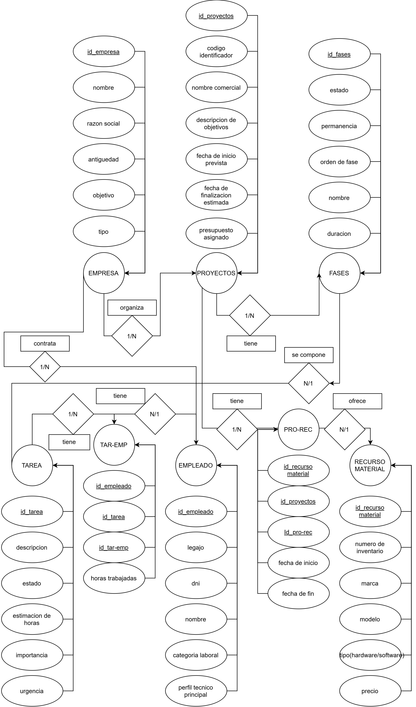

# BASE DE DATOS — Ejercicio 6: Gestión de Proyectos de Desarrollo de Software y Asignación de Recursos

Trabajo práctico de Base de Datos (Universidad Champagnat). Este repositorio contiene todo el desarrollo del ejercicio 6: modelo entidad-relación, modelo relacional y normalización (1FN, 2FN y 3FN).

## Consigna


#### Contexto


Una empresa de consultoría tecnológica en pleno crecimiento necesita un sistema de gestión interna para planificar proyectos de desarrollo de software, asignar recursos humanos según perfiles técnicos y controlar las horas dedicadas por cada colaborador a las distintas tareas.


#### Consigna


Modelar el MER para la gestión de proyectos de la consultora bajo los siguientes lineamientos:

La empresa gestiona múltiples proyectos. De cada proyecto se conoce su código identificador, nombre comercial, descripción de objetivos, fecha de inicio prevista, fecha de finalización estimada y presupuesto asignado.

Los proyectos se descomponen en fases o etapas (ej. Análisis, Diseño, Desarrollo, Testing, Despliegue), y cada fase contiene un conjunto de tareas específicas a realizar, registrando su descripción, estado y estimación de horas.

Los empleados de la empresa poseen un legajo, DNI, nombre, categoría laboral y un perfil técnico principal (ej. Desarrollador Backend, Diseñador UX, Tester QA, DevOps).

Los empleados participan en los proyectos realizando tareas. Un empleado puede trabajar en varios proyectos y en distintas tareas, y una tarea puede ser asignada a uno o varios empleados según su complejidad. Se debe registrar obligatoriamente la cantidad de horas reales trabajadas por cada empleado en cada tarea.

La empresa utiliza herramientas de software y hardware (recursos materiales) identificados por un número de inventario, marca y modelo, los cuales pueden ser asignados temporalmente a un proyecto específico.


#### Desarrollo requerido


Identificar las entidades jerárquicas del proyecto (Proyecto, Fase, Tarea) y establecer sus relaciones de dependencia o composición.

Modelar la relación N:M entre Empleado y Tarea, incluyendo el atributo cuantitativo de control de tiempo (horas trabajadas).

Incorporar la entidad Recurso Material y definir su asociación con la entidad Proyecto.

Validar que las claves primarias y foráneas garanticen la integridad referencial en todo el ciclo de vida del proyecto.

## Estructura del repositorio

```
BASE_DE_DATOS_Ejercicio_6/
├── README.md
├── modelo-er/
│   ├── ejercicio_6.drawio        # diagrama editable (draw.io)
│   └── ejercicio_6.png           # exportación del diagrama
├── modelo-relacional/
│   ├── ejercicio_6_MR.xlsx               # modelo relacional
│   └── ejercicio_6_con_datos.xlsx        # modelo relacional con datos de ejemplo
└── normalizacion/
    ├── ejercicio_6_1FN.xlsx
    ├── ejercicio_6_2FN.xlsx
    └── ejercicio_6_3FN.xlsx
```

## Modelo entidad-relación



Archivo editable: [`modelo-er/ejercicio_6.drawio`](modelo-er/ejercicio_6.drawio).

## Modelo relacional

Tablas del modelo relacional original, antes de normalizar (`(PK)` clave primaria, `(FK)` clave foránea, `(UNIQUE)` valor único):

- **EMPRESA**: `Id_empresa(PK)`, `tipo`, `objetivo`, `antiguedad`, `razon social`, `nombre`
- **PROYECTOS**: `Id_proyectos(PK)`, `codigo identificador(UNIQUE)`, `nombre comercial`, `descripcion de objetivos`, `fecha de inicio previsto`, `fecha de finalizacion estimada`, `presupuesto asignado`, `id_empresa(FK)`
- **FASE**: `Id_fase(PK)`, `estado`, `permanencia`, `orden de fases`, `nombre`, `duracion`, `Id_proyectos(FK)`
- **TAREA**: `Id_tarea(PK)`, `descripcion`, `estado`, `estimacion de horas`, `importancia`, `urgencia`, `Id_fase(FK)`
- **EMPLEADO**: `id_empleado(PK)`, `legajo(UNIQUE)`, `dni(UNIQUE)`, `nombre`, `categoria laboral`, `perfil tecnico principal`, `id_empresa(FK)`
- **TAR-EMP**: `id_tar-emp(PK)`, `id_empleado(FK, PK)`, `Id_tarea(FK, PK)`, `horas trabajadas`
- **PRO-REC**: `id_pro-rec(PK)`, `id_proyectos(FK, PK)`, `Id_recurso materiaL(FK, PK)`, `fecha de inicio`, `fecha de fin`
- **RECURSO MATERIAL**: `id_recurso material(PK)`, `numero de inventario(UNIQUE)`, `marca`, `modelo`, `tipo(HARDWARE/SOFTWARE)`, `precio`

Archivos: [`ejercicio_6_MR.xlsx`](modelo-relacional/ejercicio_6_MR.xlsx) y [`ejercicio_6_con_datos.xlsx`](modelo-relacional/ejercicio_6_con_datos.xlsx).

## Lógica relacional

Cada entidad se convierte en una tabla con su clave primaria. Las relaciones se representan así:

- **1:N / N:1**: la clave primaria del lado "uno" se copia como clave foránea (FK) en la tabla del lado "muchos".
- **1:1**: igual que 1:N, pero la FK lleva restricción UNIQUE.
- **N:M**: se crea una tabla intermedia cuyas FK forman una clave compuesta, junto con una clave propia que se identifica por esa combinación.

Relaciones del modelo final (3FN):

- `PROYECTOS` → `EMPRESA`: **N:1** (FK `id_empresa` en `PROYECTOS`).
- `FASE` → `PROYECTOS`: **N:1** (FK `id_proyectos` en `FASE`).
- `TAREA` → `FASE`: **N:1** (FK `id_fase` en `TAREA`).
- `EMPLEADO` → `EMPRESA`: **N:1** (FK `id_empresa` en `EMPLEADO`).
- `EMPLEADO` ↔ `TAREA`: relación **N:M**, resuelta con la tabla intermedia `TAR-EMP` (sus FK forman la clave compuesta única).
- `PROYECTOS` ↔ `RECURSO MATERIAL`: relación **N:M**, resuelta con la tabla intermedia `PRO-REC` (sus FK forman la clave compuesta única).

## Normalización

Los cambios se muestran etapa por etapa; cada etapa parte del resultado de la anterior.

### Primera forma normal (1FN)

Sin cambios respecto de la etapa anterior: el modelo ya cumplía esta forma normal.

### Segunda forma normal (2FN)

Sin cambios respecto de la etapa anterior: el modelo ya cumplía esta forma normal.

### Tercera forma normal (3FN)

Sin cambios respecto de la etapa anterior: el modelo ya cumplía esta forma normal.

#### Modelo final en 3FN

- **EMPRESA**: `Id_empresa(PK)`, `tipo`, `objetivo`, `antiguedad`, `razon social`, `nombre`
- **PROYECTOS**: `Id_proyectos(PK)`, `codigo identificador(UNIQUE)`, `nombre comercial`, `descripcion de objetivos`, `fecha de inicio previsto`, `fecha de finalizacion estimada`, `presupuesto asignado`, `id_empresa(FK)`
- **FASE**: `Id_fase(PK)`, `estado`, `permanencia`, `orden de fases`, `nombre`, `duracion`, `Id_proyectos(FK)`
- **TAREA**: `Id_tarea(PK)`, `descripcion`, `estado`, `estimacion de horas`, `importancia`, `urgencia`, `Id_fase(FK)`
- **EMPLEADO**: `id_empleado(PK)`, `legajo(UNIQUE)`, `dni(UNIQUE)`, `nombre`, `categoria laboral`, `perfil tecnico principal`, `id_empresa(FK)`
- **TAR-EMP**: `id_tar-emp(PK)`, `id_empleado(FK, PK)`, `Id_tarea(FK, PK)`, `horas trabajadas`
- **PRO-REC**: `id_pro-rec(PK)`, `id_proyectos(FK, PK)`, `Id_recurso materiaL(FK, PK)`, `fecha de inicio`, `fecha de fin`
- **RECURSO MATERIAL**: `id_recurso material(PK)`, `numero de inventario(UNIQUE)`, `marca`, `modelo`, `tipo(HARDWARE/SOFTWARE)`, `precio`

Archivos: [`ejercicio_6_1FN.xlsx`](normalizacion/ejercicio_6_1FN.xlsx), [`ejercicio_6_2FN.xlsx`](normalizacion/ejercicio_6_2FN.xlsx), [`ejercicio_6_3FN.xlsx`](normalizacion/ejercicio_6_3FN.xlsx).
